<p align="center">
  
</p>

<h3 align="center">The Hickston Incident</h3>

<p align="center">
  A 1997-style first-person shooter about one delivery man, a .38, a bag of pork rinds, a bluetick hound and the county's prize hog.<br>
  Eight chapters, nine bosses that fight dirty, sixteen guns, online co-op and deathmatch with voice chat, 5v5 rounds and County Run survival.
</p>

<p align="center">
  <a href="https://treymun.github.io/crazy-legs-mundell-rampage/"><b>Play it in your browser</b></a> &nbsp;·&nbsp;
  <a href="https://github.com/treymun/crazy-legs-mundell-rampage/releases/latest"><b>Download for Windows or Android</b></a>
</p>

<p align="center">
  <a href="https://github.com/treymun/crazy-legs-mundell-rampage/releases/latest"></a>
  
  
</p>

<p align="center">
  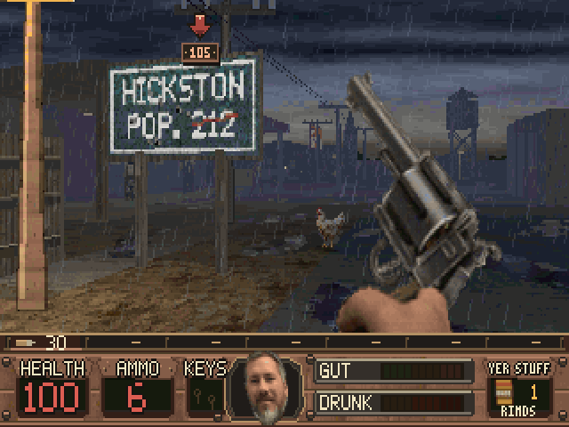
  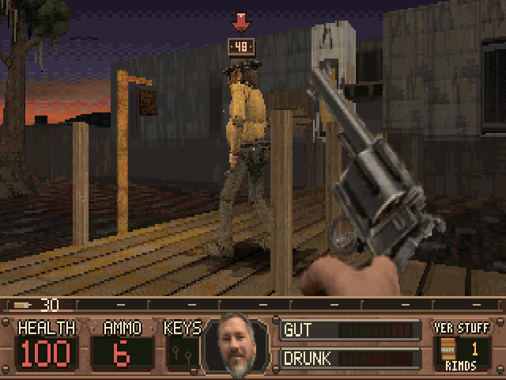
  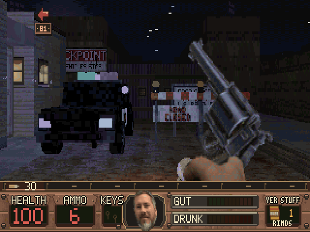
  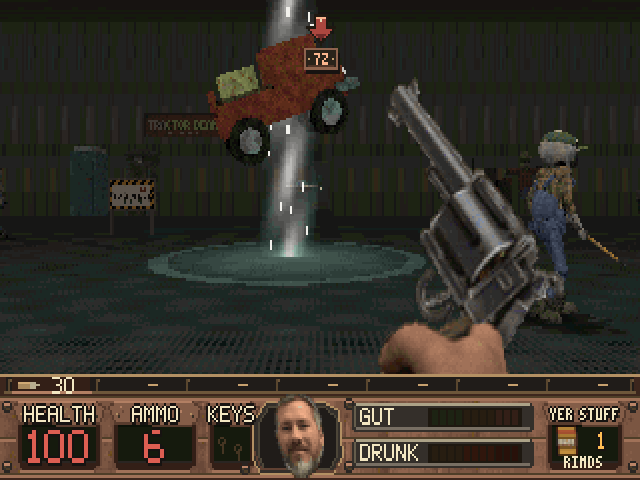
</p>

---

Something from out of county took Bessie, the prize animal of Hickston, Arkansas. Get her back:
through Stanky's Bar & Grill, the Possum County Fair, Blackwater Timber, Stillwater Cut, Gator Bayou
and the dirt track at Buzzard Bend, up Copperhead Ridge on Granny's moonshine run, then into the
ship that sent the sheriff. Alone, or with up to three friends online.

It plays like the shooters of 1997 did: 320×200, 256 colours, dusk and dirt, a gut meter and a drunk
meter, and a county full of locals who hunt you, duck for cover, run for help and brawl when they
shoot each other. It is drawn in real 3D that keeps the old look. Every picture and every sound in
it is original.

## What's in it

- **Eight chapters and a hub.** Hickston, the County Fair, Blackwater Timber, Stillwater Cut, Gator
  Bayou, Buzzard Bend Speedway, the Moonshine Run on Copperhead Ridge (by night) and the Mothership,
  joined by the County Crossroads with a gate for each. Quests to work out, keys to find, counted
  secrets, a county map that fills in as you walk, and a short 1990s cutscene to open each chapter.
- **Nine boss fights.** Each boss has an arena of its own: a floodlit rodeo ring round a crashed
  saucer, the Hogs' football field, Rudy's big top, the saw floor, the copper still house, the bayou
  lagoon, the derby bowl, the Revenue Man's still cave and Maw's throne in the core. They make an
  entrance, talk trash, mark where the next hit lands, wreck their own arenas, lose their gear to
  your shots, call in backup and, at a fifth of their health, get *plum desperate* with one last
  trick. Every boss has a weak spot, HOG WILD saves one extra attack for you, and when one goes
  down the camera stays on the fall, slowed, before the tally. Dying in a fight, or on the way up
  to one, puts you back at the arena door. **BOSS REMATCH** races any boss you have beaten
  against the clock for a blue, red or white ribbon.
- **Blue.** Mundell's bluetick coonhound, built new from nose to tail in 3.8 and calmed down in
  3.10, trots at your heel or ranges out ahead like a hunting dog, keeps out of your sights, hops
  in when you drive, bays at secret doors and guns you ain't got, pins a hurt man down, fetches,
  and minds the whistle: sic 'em, fetch, stay, come. His badge says how he feels and what he's up
  to.
- **Sixteen guns and a junk bench.** A rusted crowbar, the .38, a sawed-off with both barrels, a
  dynamite crossbow, the Ranch Rifle, the Rip Saw, an alien arm gun, hand-thrown dynamite, the
  Sling Blade, a bottle rocket launcher, the Mill Riveter, the Copperhead, a bowling ball, a powder
  keg, the Cow Launcher and the Teat Gun. Scrap buys duct-tape mods at Mundell's bench (a pawn shop
  scope, a corn knife bayonet, a drum mag, flaming bolts...). Try every gun in the **firing range**,
  which also has a games row: horseshoes, a dunk tank, skee-ball and knock 'em down.
- **Dirty fighting.** USE at a man's face is a boot that slides him into a wall, the next feller,
  a well, the hogs or the wood chipper; a reeling hand gets finished with whatever is in your hand.
  Pick things up and throw them, kick in doors, and watch the bodies go down the way they were
  hit: knees folding, going slack, thrown off their feet by buckshot from the side. Gators,
  crawlers, stampede hogs and cows fall the same way (a dead gator floats), and the sheriff,
  Jerry, Rudy, the foreman and the Revenue Man finish their falls as bodies.
- **Behind the wheel.** The Swamp King's airboat, a stock car and a riding mower, with the bayou's
  CHANNEL RUN, the speedway's HEAT RACE and Granny's load down the Moonshine blacktop.
- **The county happens to you.** Twisters, hog stampedes, revenue raids and, in the night chapters,
  a blackout with a flashlight on L. KPSM, the Possum, plays cowpunk records between Dub Tillery's
  talk about what you just blew up, and the police scanner calls in your trouble.
- **Things break the way they were hit.** Crates, barrels, coolers and mailboxes come apart where
  the round lands and the way it pushed, never the same twice, the pieces tumbling by what they
  are made of. Plank walls lose the boards you shoot, windows crack fresh and every round leaves
  its own hole; a rifle round punches through thin planks and tin to the man behind. Barns and
  sheds come down in their own boards and tin in a cloud of dust, water towers topple and flood,
  fuel lines burn, a blast looks like what went up and leaves its smoke column standing, and a
  wrecked car throws its parts across the lot.
- **A hand for greenhorns.** The first time something comes up, a short tip says what to do with
  your own keys, pad or thumbs, once a profile (NEW PLAYER TIPS on SETUP's PLAY page turns them
  off).
- **A county you can hear.** Rain on the roof over your head, a sound for every surface a round
  hits, a soundtrack of cowpunk records for every chapter with fight music and boss loops, and more
  than eight hundred voiced lines from Mundell, the bosses, the hands and the narrator. Things that
  go by fast bend as they pass, like a pickup on the county road: race cars, the cruisers' sirens,
  the Swamp King's airboat, bottle rockets that fizz and whistle by and thrown junk that whooshes.
- **Feel it.** A pad rumbles its own way for every gun, for hits from the side they came, the
  boot, blasts by how near, hard landings, engines and bosses; a phone buzzes too.
- **Any screen.** WIDE on SETUP's DISPLAY page fills a 16:9, ultra-wide or sideways phone screen
  with the same 200-row picture, seeing further to the sides, the HUD out at the edges. On a 120,
  144 or 240 Hz screen (raise FRAME LIMIT) everything moves on every frame drawn.

### Modes

- **Online, through the party line.** Title, MULTIPLAYER. HOST A GAME gives you a short code like
  `HKP-427`; friends type it in and the game's relay puts them in your lobby, with no port forwarding,
  behind any router, on a phone or in the browser. PLAY ONLINE lists the always-open county lobby
  (60 updates a second; bots fill it; the first one in runs it and picks the 5v5 or tag team) and
  every open player lobby.
  - **CAMPAIGN CO-OP** for two to four, from a chapter the host has reached or THE PARTY SAVE.
  - **DEATHMATCH** and **TEAM DEATHMATCH** for two to four, in the boss arenas, the Crossroads, the
    range, the versus maps or your own.
  - **SEARCH AND DESTROY** and **HOSTAGE RESCUE**, 5v5 outlaws against deputies with a buy menu,
    ten side guns, four throwables and store RULES; **TAG TEAM 2V2** on three small maps. PLAY VS
    BOTS plays them offline.
  - **COUNTY RUN CO-OP** for two to four, sharing one build.

  The host's game is the real one; everyone else's copy is drawn between the ticks on a steady
  clock, so it plays as smooth online as alone. Your own aim, walking, shots, reloads, hits,
  pickups, dynamite, blasts, scope, boot, doors and pocket items show the moment you press, and so
  do a sure kill, a finisher and what your rounds break; the host judges your shots where your
  screen showed them, further back for a slow line. Everyone needs the same version. There is no
  split screen: a friend in the same house joins from his own machine. The details are in
  [docs/online.md](docs/online.md).

  **Proximity voice chat** in every online game, the browser and the phone too: turn MICROPHONE on
  under SETTINGS, AUDIO (it starts off), then hold **T** (a pad's share button, the phone's TALK
  button) or pick OPEN MIC. Voices carry about eighteen steps, placed where the talker stands,
  muffled through walls and given a CB radio's crackle; the lobby hears everybody, and in a 5v5
  round only the dead hear the dead. Click a name in the lobby to mute him. Nothing said is kept.
  VOICE QUALITY on the AUDIO page is CLEAR 16K by default: the s's and t's come through and it
  still sounds like a CB. CB 8K is the old squawk and lighter on a phone's data; CLEAR goes only
  where both ends have it and falls back to CB 8K on a busy or poor line.
- **COUNTY RUN.** Endless survival on three big maps (Hickston, the quarry, Gator Bayou): XP from the
  dead, three cards at every level, a milestone every tenth, a storm front closing in, and a DAILY
  RUN with the same dice for everybody and a board. See [COUNTY_RUN.md](COUNTY_RUN.md).
- **CUSTOM MAPS and the MAP SHED.** Paint a map in the game (ground, buildings, steps, hands, loot,
  props, marks), test it, and play it alone, against bots, as a County Run or online; joiners get a
  checked copy on the way in. Developers build the real levels from structured map sources:
  [MAP_AUTHORING.md](MAP_AUTHORING.md).

<p align="center">
  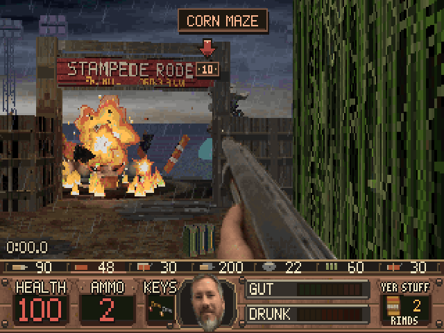
  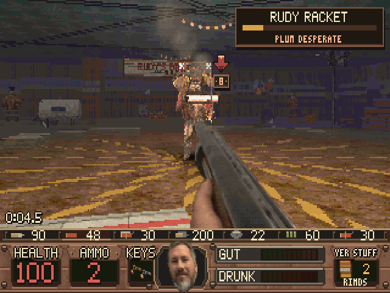
  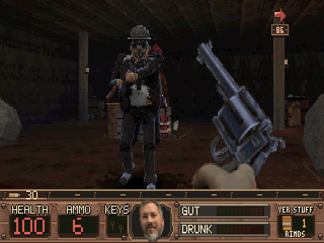
  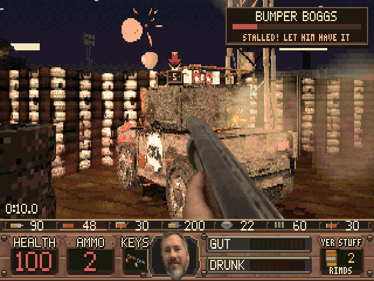
</p>
<p align="center">
  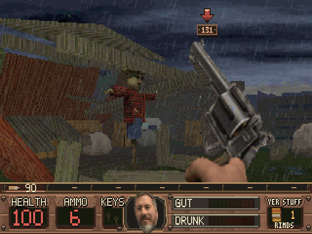
  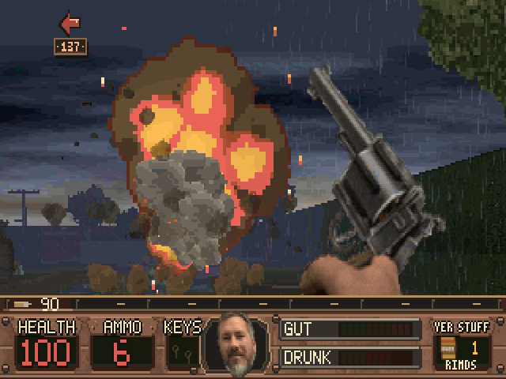
  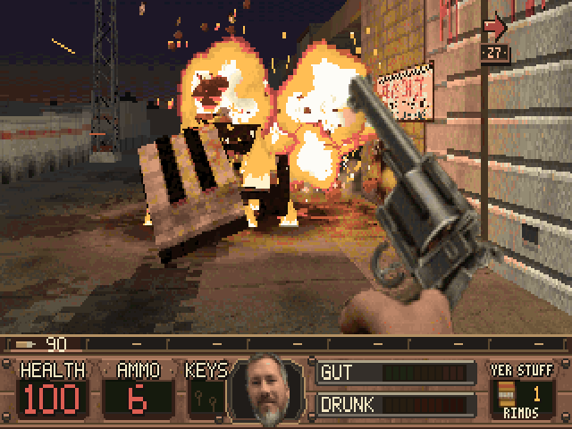
  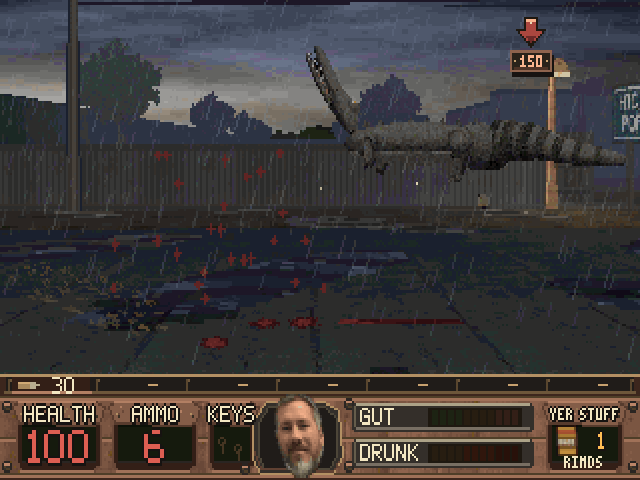
</p>
<p align="center">
  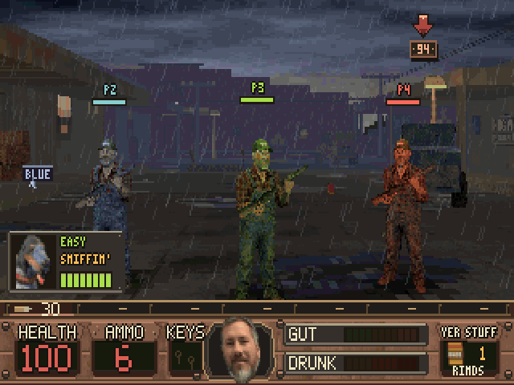
  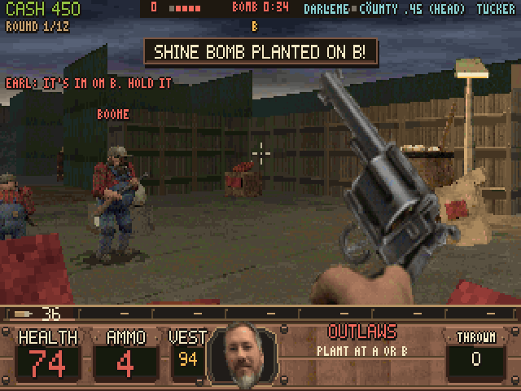
  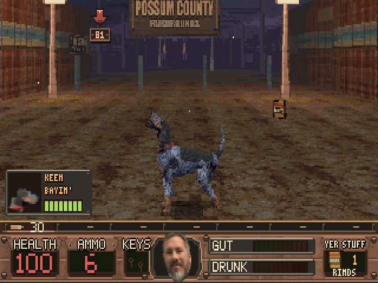
  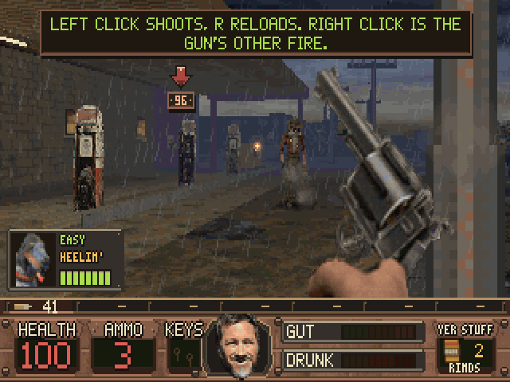
</p>

## Lately

- **3.12** Touch fixed in the phone browser (SETTINGS, saves and party line codes by finger, the
  phone's keyboard for names); a WIDE view for 16:9 and wider; every frame drawn moves at 120 to
  240 Hz; rumble on pads and phones; Doppler on fast movers; CLEAR 16K voice chat; chapters load
  their first time up to 0.3 s quicker; Android fetches its own updates.
- **3.11** Proximity voice chat online; one always-open lobby at 60 updates a second; sure kills,
  breaks, finishers and pocket items at the press online and no jolt on a leave or join; gators,
  crawlers, hogs and cows die as bodies (gators float) and five bosses finish their falls as
  ragdolls; Jerry, Rudy and the foreman re-baked sharp; heavy scenes 5 to 11 percent faster.
- **3.10** Online as smooth as single-player (drawn between ticks on a render clock, shots,
  blasts and doors at the press, County Run co-op on the clock); Blue calm and readable; tips for
  new players; a boss's checkpoint taken on the way to his door.
- **3.9** Destruction: breaks driven by the hit, pieces by material, barns, water towers and fuel
  lines coming apart, plank walls and windows broken where shot, blasts by what blew, wrecks
  throwing parts, ragdolls fixed and driven by the hit.
- **3.8** Blue rebuilt; music and a smooth camera under the chapter openers; boss endings; about
  twice as fast in normal play, quicker loads and smaller hitches.

## Play

| Where | What you get |
| --- | --- |
| **Browser** | <https://treymun.github.io/crazy-legs-mundell-rampage/>: desktop Chrome, Edge or Firefox. About 80 MB on the first visit (the title and Hickston); each later chapter comes down while you play, and the browser keeps it all. Plays online by party line code. iPhone and iPad get a lighter build. |
| **Windows** | `CrazyLegsMundellRampage.exe` (one file, no install) or `CrazyLegsMundellRampage_Setup.exe` (Start-menu shortcut and uninstaller). Windows 10 or 11, 64-bit, OpenGL 3.3. |
| **Android** | `CrazyLegsMundellRampage.apk`: Android 7.0 or newer, arm64, held sideways. Touch controls, or plug in a gamepad. |

The downloads are on the [latest release](https://github.com/treymun/crazy-legs-mundell-rampage/releases/latest).
Saves stay on your machine.

### Updating

The Windows and Android builds ask the website once at start whether a newer version is out (only
the version number comes back; turn it off with CHECK FOR UPDATES on the PLAY page of SETTINGS,
and nothing at all is fetched). When one is, a sign on the title says NEW VERSION ... GIT IT.

- **Windows:** pick the sign and the installer's download starts in your browser; run it when it
  is down. It goes over the old install; saves are kept.
- **Android:** pick GIT IT and the new version comes down inside the game with a gauge (keep
  playing meanwhile; a dropped line picks up where it left off), is checked against the size and
  checksum published with the release, and is handed to Android: tap **Update** when your phone
  asks. The first time, the game says ONE SWITCH: tap SETTIN'S and allow it to install updates,
  then come back. **For now each release is signed with a key of its own,** so Android will not
  put a new one over the old: uninstall the old copy first (this loses its saves), then install
  the new APK from the release page. Once the game's lasting key is in place, updates go straight
  over the last copy and keep your saves.

### Controls

| Keyboard and mouse | | Gamepad | |
| --- | --- | --- | --- |
| W A S D, mouse | Move and aim | Left / right stick | Move / look |
| Shift, J, Z | Run, jump, crouch | Right / left trigger | Fire / alt fire |
| Mouse 1 / Mouse 2 | Fire / alt fire | A / B | Jump / crouch |
| E, Space, middle click | Use, open, rescue; boot, finish; hold to revive | X / Y | Reload / use |
| 1–9, 0, -, =, \\, wheel | Weapons | Bumpers | Previous / next weapon |
| R | Reload | L3 / R3 | Run / flashlight (R3 runs when there's none) |
| 8, hold fire | Light the stick; let go to throw | D-pad up, left, right | Rinds, beer, moonshine |
| C, B, M | Pork rinds, beer, moonshine | D-pad down | Use the picked item |
| Q / F | Pick an item / use it | Start / Back | Pause / county map |
| G | Whistle for Blue | Hold Back | Whistle for Blue |
| L | Flashlight (in a blackout) | | |
| Tab / P | County map / photo mode | | |
| F6 / F9 / F5 | Quicksave, quickload, save slots | | |
| F11, F4, F12 | Fullscreen, music, screenshot | | |
| T, held | Talk online (push to talk) | Share button | Talk online |

Every play key can be changed on SETUP's KEYS page, and CONTROLS on the menu names them as you set
them. USE picks up loose junk; fire chucks it and alt fire sets it down. NEW PLAYER TIPS on SETUP's
PLAY page shows a short tip the first time something comes up (on by default). CHECKPOINTS on the
PLAY page: TRAIL MARKERS (the default) ties a marker on the way through a chapter, so a death picks
up from the last one (ENTER, A or a tap: BACK TO THE MARKER; R, X or the lower line: the chapter's
start); BOSSES ONLY keeps just the boss doors, as before. BETWEEN CHAPTERS on the PLAY page:
STRAIGHT ON (the default) takes one tap from a won chapter's card straight into the next chapter,
kit and all; THE CROSSROADS goes to the hub first, standing at the next gate. The card offers the
other way too (Tab, Y or its sign) and TRY TO BEAT IT (R, X), the chapter again against your best
time, par and most kills. DANGER ARROWS on the DISPLAY page (on by
default): a red mark at the edge of the view points at whatever hit you, an amber one at a varmint
winding up out of sight; OFF goes back to the words. ENEMY RIM on the DISPLAY page
(SOFT by default, with LIGHTS AND GLOW): a varmint that has seen you wears a dull warm
edge round his outline, a touch stronger far off so a hand down the road reads; BOLD
makes it a brighter line, OFF takes it away. RUMBLE on the INPUT
page shakes a pad (FULL by default); PHONE RUMBLE on the TOUCH page buzzes an Android phone, or a
phone browser that can (LOW by default; an iPhone's browser cannot).

On a touch screen the left thumb walks and a drag on the right half aims; FIRE, ALT, USE (hold it
to revive), NEXT, JUMP and DUCK sit on the right, and RIND, BEER, SHINE, MAP, PHOTO and MENU along
the top, with LIGHT and WHISTLE when there is a flashlight or a hound to work. Every menu takes a
tap, the settings bars follow a finger, and tapping a name or a party line code brings up the
phone's keyboard. Rinds fill the gut
and mend you, beer mends you and makes the county sway, and moonshine sobers you up and buys seven
seconds of running like you stole it.

## Building it

The game is the Godot 4.7.2 project in `godot/`. It started as a port of a Python/pygame game, kept
at the git tag `python-original`.

```
godot --headless --path godot --script res://tools/pack_assets.gd   # asset packs, no Python needed
godot --headless --path godot --import
godot --headless --path godot --export-release "Windows Desktop" build/windows/CrazyLegsMundellRampage.exe
godot --headless --path godot --script res://tools/pack_lite.gd     # browser and phone copy (ffmpeg on PATH)
godot --headless --path godot --export-release "Web" build/web/index.html
godot --headless --path godot --script res://tools/make_packs.gd -- build/web   # the chapter packs
godot --headless --path godot --export-release "Android" build/android/CrazyLegsMundellRampage.apk
ISCC installer.iss
```

`pack_assets.gd` writes `godot/assets_gen/*.bin` (about 170 MB, not committed) from `assets/`,
`audio_src/` and `godot/assets/music` in a few seconds; `pack_lite.gd` writes the lighter copy the
browser and phone builds read (`assets_gen/lite`: the biggest model textures halved, the pictures as
lossless WebP, the music and spoken lines re-encoded smaller). The exports need Godot 4.7.2 with its
export templates; Android also needs JDK 17, the Android SDK and a keystore.

Every check runs headless, each in its own process and scratch profile:

```
godot --headless --path godot --script res://tools/check_all.gd -- quick   # about a minute
godot --headless --path godot --script res://tools/check_all.gd -- lint    # everything, plus gdformat and gdlint
```

They cover gdformat and gdlint, the shader texture count, the assets, the regression and feature
checks (bosses, the hound, events, vehicles, breakables, rematches and more), the old-save fixtures,
the networking (snapshots, the party line, a lobby server, online co-op and 5v5 played by bots),
the level editor, quest reach, a bot playing the whole campaign, and the 3D view's reference
pictures. Tools that play the game write into a scratch profile, never yours.

`.github/workflows/release.yml` runs the checks in six parallel shards and the 3D view's picture
comparison on every push, builds the browser builds and deploys this landing page on `main`, and on
a `v*` tag builds and publishes the Windows EXE, installer and APK. The APK is signed with the
lasting key in `ANDROID_KEYSTORE_BASE64`, `ANDROID_KEYSTORE_USER` and `ANDROID_KEYSTORE_PASSWORD`,
so each release installs over the last; a tag without them fails rather than publish an APK signed
with a throwaway key (branch and hand-started builds still use one).

## How it is put together

- **`godot/src/`**, the game in GDScript, strictly typed. The front end is a chain of layers
  (`main_state` → `main_flow` → `main_input` → `main`), and so is play (`game_state` → `game_world` →
  `game_combat` → `game_view` → `game`); a layer only calls down. New pieces of play are features in
  `src/features/` that listen to the game's events; the bosses' moves are in `src/bosses/`, the modes
  in `src/modes/`, the networking in `src/net/`, the menu screens in `src/ui/`.
- **The view.** `src/view3d/` draws the world in real 3D that keeps the 320×200 look: `game_view.gd`
  hands each frame (the eye, sprites, marks) to `WorldView3D`, which renders the level mesh, the
  rigged enemies and bosses, the modelled props, vehicles, wreck pieces, sky, rain and shadows into
  a 320×156 view (160×78 on LOW, 640×312 in HD) with a camera that looks up and down the way the
  Build engine did, so aim and the crosshair stay true. `src/display.gdshader` then lays the gun,
  HUD and menus over it and makes the picture players see: the moonshine warp, heat haze, grain,
  dither and the 256-colour palette. Window tours are held to the reference pictures in
  `godot/tools/pictures_3d/`.
- **Multiplayer.** The host runs the one real game at 60 ticks a second and sends each player
  snapshots of what changed; every client steps its own copy with everyone's controls and predicts
  its own player. The same code runs the always-open lobby server and the party line relay
  (`server/`). See `docs/dev/multiplayer.md` and `docs/dev/modes.md`.
- **Levels** are `godot/data/*.json`, built from hand-written plans in `godot/tools/levels/`; every
  number for guns, enemies, bosses, shots, effects, breakables, vehicles, events, the hound, the
  store and County Run is in `godot/data/tuning/`.
- **Art** is made by the Godot tools in `godot/tools/art/`, with Blender building and rendering the 3D
  enemies, bosses, guns, props and vehicles (`scripts/blender/`). **Sound** is produced from
  `audio_src/` by `scripts/audio_build.py` (`audio_src/README.md` explains it); a normal build never
  contacts a sound service.
- **The landing page** is plain HTML, CSS and JavaScript in `site/`;
  `scripts/build_site_assets.py` rebuilds its pictures and sound previews from the game, and says
  how its window captures are taken.

`CLAUDE.md` has the full list of commands, checks and things that are easy to get wrong, and
`docs/dev/` the developer docs.

---

<sub>Made in the spirit of the redneck shooters of the late nineties. Every asset is original; no art,
sound or maps from any other game are used.</sub>
