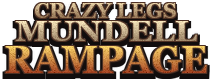
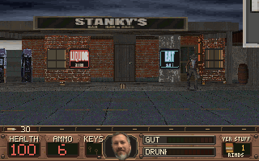
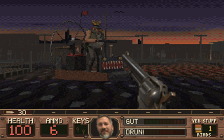
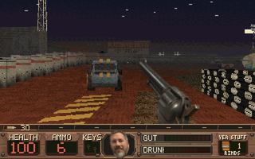
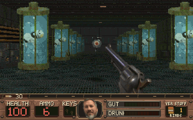
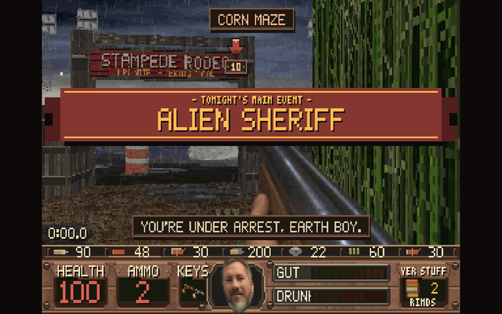
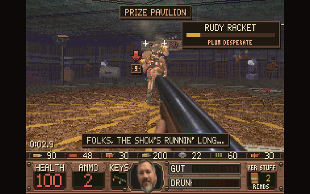
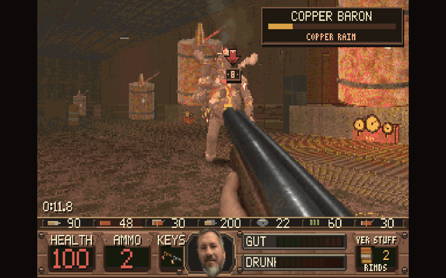
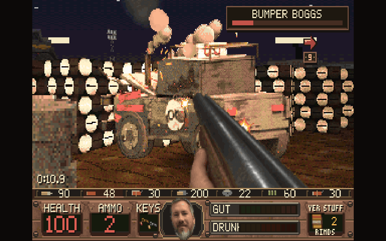

<p align="center">
  
</p>

<h3 align="center">The Hickston Incident</h3>

<p align="center">
  A 1997-style first-person shooter about one delivery man, a .38, a bag of pork rinds and the county's prize hog.<br>
  Seven chapters, a county crossroads, a firing range, sixteen guns and eight bosses that fight dirty.
</p>

<p align="center">
  <a href="https://treymun.github.io/crazy-legs-mundell-rampage/"><b>Play it in your browser</b></a> &nbsp;·&nbsp;
  <a href="https://github.com/treymun/crazy-legs-mundell-rampage/releases/latest"><b>Download for Windows or Android</b></a>
</p>

<p align="center">
  <a href="https://github.com/treymun/crazy-legs-mundell-rampage/releases/latest"></a>
  
  
</p>

<p align="center">
  
  
  
  
</p>

---

Something from out of county took Bessie, the prize animal of Hickston, Arkansas. Get her back:
through Stanky's Bar & Grill, the Possum County Fair, Blackwater Timber, Stillwater Cut, Gator Bayou
and the dirt track at Buzzard Bend, then up into the ship that sent the sheriff.

It plays like the shooters of 1997 did: 320×200, 256 colours, dusk and dirt, a gut meter and a drunk
meter, and a county full of locals who hunt you, duck for cover, run for help and brawl when they
shoot each other. Every picture and every sound in it is original.

## What's in it

- **Seven chapters and a hub.** Hickston, the County Fair, Blackwater Timber, Stillwater Cut, Gator
  Bayou, Buzzard Bend Speedway and the Mothership, joined by the County Crossroads with a gate for
  each. Quests to work out, keys to find, counted secrets, a county map that fills in as you walk.
- **Eight boss fights, rebuilt.** Each boss has an arena of its own: a floodlit rodeo ring round a
  crashed saucer, the Hogs' football field, Rudy's big top, the saw floor, the copper still house,
  the bayou lagoon, the derby bowl and Maw's throne in the core. They make an entrance, talk trash,
  mark where the next hit lands, wear the beating they take, call in backup and, at a fifth of their
  health, get *plum desperate* with one last trick while the arena turns on everybody. Every boss
  has a weak spot, HOG WILD saves one extra attack for you, and dying in a fight puts you back at the
  arena door.
- **BOSS REMATCH** on the title menu: refight any boss you have beaten against the clock for a blue,
  red or white ribbon, with your best times kept.
- **Sixteen guns.** A rusted crowbar, the .38, a sawed-off with both barrels, a dynamite crossbow,
  the Ranch Rifle, the Rip Saw, an alien arm gun, hand-thrown dynamite, the Sling Blade, a bottle
  rocket launcher, the Mill Riveter, the Copperhead, a bowling ball, a powder keg, the Cow Launcher
  and the Teat Gun. Try them all in the **firing range** off the title menu.
- **Things break and move.** Crates, barrels, jugs, coolers and signs break; fuel drums, propane and
  nitro chain-explode; windows shoot out and stockyard fences give way. Bodies get thrown by what hit
  them, gibs bounce, and a rifle round punches through thin planks and tin to the man behind.
- **A county you can hear.** Rain on the yard and on the roof over your head, burn barrels and stills
  as you pass, a sound for every surface a round hits, a soundtrack of cowpunk records for every
  chapter with fight music and boss loops, and bosses who talk back.
- **Looks the part.** Weather, puddles, lightning and fog banks, coloured lamplight and heat shimmer,
  layered explosions and muzzle flashes, all drawn by the graphics card, with an optional HD view.

<p align="center">
  
  
  
  
</p>

## Play

| Where | What you get |
| --- | --- |
| **Browser** | <https://treymun.github.io/crazy-legs-mundell-rampage/>: desktop Chrome, Edge or Firefox. About 65 MB on the first visit, then the browser keeps it. iPhone and iPad get a lighter build. |
| **Windows** | `CrazyLegsMundellRampage.exe` (one file, no install) or `CrazyLegsMundellRampage_Setup.exe` (Start-menu shortcut and uninstaller). Windows 10 or 11, 64-bit, OpenGL 3.3. |
| **Android** | `CrazyLegsMundellRampage.apk`: Android 7.0 or newer, arm64, held sideways. Touch controls, or plug in a gamepad. |

The downloads are on the [latest release](https://github.com/treymun/crazy-legs-mundell-rampage/releases/latest).
Saves stay on your machine.

### Controls

| Keyboard and mouse | | Gamepad | |
| --- | --- | --- | --- |
| W A S D, mouse | Move and aim | Left / right stick | Move / look |
| Shift, J, Z | Run, jump, crouch | Right / left trigger | Fire / alt fire |
| Mouse 1 / Mouse 2 | Fire / alt fire | A / B | Jump / crouch |
| E, Space, middle click | Use, open, rescue | X / Y | Reload / use |
| 1–9, 0, -, =, wheel | Weapons | Bumpers | Previous / next weapon |
| R | Reload | Stick click | Run |
| 8, hold fire | Light the stick; let go to throw | D-pad up, left, right | Rinds, beer, moonshine |
| C, B, M | Pork rinds, beer, moonshine | D-pad down | Use the picked item |
| Q / F | Pick an item / use it | Start / Back | Pause / county map |
| Tab | County map | | |
| F6 / F9 / F5 | Quicksave, quickload, save slots | | |
| F11, F4, F12 | Fullscreen, music, screenshot | | |

On a touch screen the left thumb walks and a drag on the right half aims; the buttons appear the
first time a finger lands. Rinds fill the gut and mend you, beer mends you and makes the county sway,
and moonshine sobers you up and buys seven seconds of running like you stole it.

## Building it

The game is the Godot 4.7.2 project in `godot/`. It started as a port of a Python/pygame game, kept
at the git tag `python-original`.

```
godot --headless --path godot --script res://tools/pack_assets.gd   # asset packs, no Python needed
godot --headless --path godot --import
godot --headless --path godot --export-release "Windows Desktop" build/windows/CrazyLegsMundellRampage.exe
godot --headless --path godot --export-release "Web" build/web/index.html
godot --headless --path godot --export-release "Android" build/android/CrazyLegsMundellRampage.apk
ISCC installer.iss
```

`pack_assets.gd` writes `godot/assets_gen/*.bin` (about 70 MB, not committed) from `assets/`,
`audio_src/` and `godot/assets/music` in a few seconds. The exports need Godot 4.7.2 with its export
templates; Android also needs JDK 17, the Android SDK and a keystore.

Every check runs headless, all at once, in about two minutes:

```
godot --headless --path godot --script res://tools/check_all.gd -- lint
```

It runs gdformat and gdlint, the shader texture count, the asset check, the regression and feature
checks (bosses, breakables, rematches and more), the old-save fixtures, the level editor, quest reach,
a bot playing the whole campaign, and the reference pictures. Tools that play the game write into a
scratch profile, never yours.

`.github/workflows/release.yml` runs the checks and the shader-view comparison on every push, builds
the Windows EXE, installer, APK and browser build on `main`, deploys this landing page, and on a `v*`
tag publishes the release. Set `ANDROID_KEYSTORE_BASE64`, `ANDROID_KEYSTORE_USER` and
`ANDROID_KEYSTORE_PASSWORD` to sign the APK with a lasting key.

## How it is put together

- **`godot/src/`** — the game in GDScript. Play is a chain of layers (`game_state` → `game_world` →
  `game_combat` → `game_view` → `game`); new pieces of play are features in `src/features/` that
  listen to the game's events. The bosses' moves are in `src/bosses/`.
- **The view.** With a window, `palette.gdshader` composes the picture on the graphics card from layers
  the renderer hands over: sky, floors, walls, sprites, lights, weather, then the gun and HUD and the
  256-colour grade. Headless tools draw the same picture in software, and reference pictures in
  `godot/tools/pictures*/` hold both to the pixel.
- **Levels** are `godot/data/*.json`, built from hand-written plans in `godot/tools/levels/`; the
  numbers for guns, enemies, shots, effects and breakables are in `godot/data/tuning/`.
- **Art** is made by the Godot tools in `godot/tools/art/`, with Blender rendering the 3D enemies,
  bosses, guns and props. **Sound** is produced from `audio_src/` by `scripts/audio_build.py`
  (`audio_src/README.md` explains it); a normal build never contacts a sound service.
- **The landing page** is plain HTML, CSS and JavaScript in `site/`;
  `scripts/build_site_assets.py --audio` rebuilds its pictures and sound previews from the game.

`CLAUDE.md` has the full list of commands, checks and things that are easy to get wrong.

---

<sub>Made in the spirit of the redneck shooters of the late nineties. Every asset is original; no art,
sound or maps from any other game are used.</sub>
