# Map catalog

Made by `godot --headless --path godot --script res://tools/map.gd -- catalog`; do not edit by hand. 1 map unit = 1 cell; eye .95 over a floor; door 1.85; step .245; body radius .2, height 1.12.

## Components (object types)

| type | cells | required | what it is |
| --- | --- | --- | --- |
| `yard` | yes | rect, floor | Open ground under the sky over whole cells. |
| `room` | yes | rect, floor | Open floor under a roof `roof` high (cells); walls come from solid cells round it. |
| `building` | yes | rect | A ring of wall cells round a room; cut doors with `door`. |
| `solid` | yes | rect, tile | Solid cells: a wall, hedge, rock or fence `top` high. |
| `fence` | yes | rect | A fence of solid cells (breakable where breakables.cfg says). |
| `paint` | yes | rect, floor | A floor tile over cells (a path, a rug, mud). |
| `raise` | yes | rect, ground | Cells' ground raised (or sunk) to `ground` (a step up needs <= .245). |
| `light` | yes | at | A pool of lamp light on the cells round `at`. |
| `door` | yes | cell | A door in a wall cell (a grid door: 1 cell wide, 1.85 high). |
| `gap` | yes | cell, from | An open doorway in a wall cell, no door. |
| `pane` | yes | cell | A breakable glass pane across a cell. |
| `deck` | no | rect, top | A floor walked on and under (a loft, a landing, a catwalk), `thick` thick. |
| `block` | no | rect, top | A solid block standing on the ground (a plinth, a dock, a stage), walked on. |
| `ramp` | no | rect, from, to, toward | A slope from z `from` up to `to` toward n/e/s/w (solid to the ground unless `thick`). |
| `stairs` | no | rect, from, to, toward | Stairs from `from` up to `to` toward n/e/s/w, treads `rise` high at most. |
| `wall` | no | a, b | A free wall a to b; `openings` [{id, at, width, sill, head}] cut doors and windows. |
| `rail` | no | a, b | A rail standing on z: stops bodies, not looks or shots. |
| `cover` | no | a, b | Low solid cover a to b: stops bodies, looks and shots under its top. |
| `balcony` | no | rect, top, open | A deck railed on the `open` sides (n, e, s, w); `gaps` [[side, from, to]]. |
| `bridge` | no | rect, top | A deck across a gap at `top`, railed along its long sides; walk under it. |
| `ceiling` | no | rect, z | A flat surface overhead (an overhang, a porch roof, an upper room's ceiling). |
| `room_poly` | yes | points, floor | A room of any outline, a wall on each edge; `openings` [[edge, {at, width}]]. |
| `corridor` | yes | points, floor | A roofed passage `width` cells wide along a path of cell centres (straight legs, n/s/e/w). |
| `fixture` | no | rect, top | A box of furniture (a counter, a crate stack): stops bodies; not walked on. |
| `prop` | no | name, at | A modelled prop (town_props.json names) standing at `at`. |
| `sign` | no | image, at, height | A flat picture standing at `at` (a sign, a board). |
| `enemy` | no | kind, at | A hand of `kind` (enemies.cfg) standing at `at`, on the floor at or under z. |
| `pickup` | no | name, at | A pickup lying at `at`. |
| `station` | no | at, label | An objective: a quest station used at `at`; `opens` door cells; `prop` a town_quest_<name>. |
| `exit` | no | at, label | The level's exit (extraction) at `at`, open once `shutdown` is done. |
| `spawn_point` | no | at | A named place a player or bot can start a playtest from (and a versus spawn). |
| `label` | no | text, at | A name on the automap. |
| `allow_overlap` | no | objects, reason | Says two or more objects overlap on purpose (validate stops calling it an error). |

## Tiles (materials)

| | id | notes |
| --- | --- | --- |
|  | `wood` | strikes as wood, footstep gravel, variants wood |
|  | `barn` | strikes as wood, footstep gravel, variants barn, barn_win, barn_lit, barn_brk |
|  | `tin` | strikes as tin, footstep gravel, variants tin, tin_win, tin_lit, tin_brk |
|  | `brick` | strikes as brick, footstep gravel, variants brick, brick_win, brick_lit, brick_brk |
| 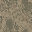 | `plaster` | strikes as stone, footstep gravel, variants plaster, plaster_win, plaster_lit, plaster_brk |
|  | `tile` | strikes as stone, footstep gravel, variants tile |
|  | `mirror` | strikes as glass, footstep gravel, variants mirror |
| 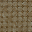 | `floor_tile` | strikes as stone, footstep tile, variants floor_tile |
| 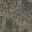 | `concrete` | strikes as stone, footstep tile, variants concrete |
| 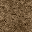 | `dirt` | strikes as dirt, footstep mud, variants dirt |
| 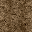 | `tracks` | strikes as dirt, footstep mud, variants tracks |
| 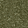 | `grass` | strikes as dirt, footstep grass, variants grass |
|  | `asphalt` | strikes as dirt, footstep gravel, variants asphalt |
| 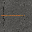 | `road` | strikes as dirt, footstep gravel, variants road |
| 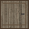 | `door` | strikes as wood, footstep gravel, variants door |
| 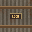 | `gate` | strikes as steel, footstep gravel, variants gate |
|  | `liquor` | strikes as wood, footstep gravel, variants liquor |
|  | `eat` | strikes as wood, footstep gravel, variants eat |
|  | `restroom` | strikes as wood, footstep gravel, variants restroom |
|  | `barnsign` | strikes as wood, footstep gravel, variants barnsign |
|  | `warning` | strikes as wood, footstep gravel, variants warning |
| 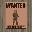 | `wanted` | strikes as wood, footstep gravel, variants wanted |
| 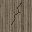 | `crack` | strikes as wood, footstep gravel, variants crack |
| 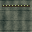 | `ship` | strikes as steel, footstep gravel, variants ship |
| 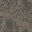 | `ceiling` | strikes as wood, footstep gravel, variants ceiling |
|  | `joists` | strikes as wood, footstep gravel, variants joists |
|  | `tavern` | strikes as stone, footstep gravel, variants tavern |
|  | `shelves` | strikes as wood, footstep gravel, variants shelves |
|  | `fascia` | strikes as wood, footstep gravel, variants fascia |
|  | `window` | strikes as glass, footstep gravel, variants window |
|  | `cinder` | strikes as stone, footstep gravel, variants cinder, cinder_win, cinder_lit, cinder_brk |
|  | `porch` | strikes as wood, footstep wood, variants porch |
|  | `counter` | strikes as wood, footstep gravel, variants counter |
|  | `counter_top` | strikes as stone, footstep gravel, variants counter_top |
|  | `crate_side` | strikes as wood, footstep gravel, variants crate_side |
| 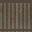 | `steel_mesh` | strikes as mesh, footstep gravel, variants steel_mesh |
| 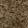 | `shoulder` | strikes as dirt, footstep mud, variants shoulder |
|  | `gravel` | strikes as dirt, footstep gravel, variants gravel |
|  | `stockyard` | strikes as wood, footstep gravel, variants stockyard |
|  | `trailer` | strikes as tin, footstep gravel, variants trailer, trailer_brk |
|  | `trailer_window` | strikes as tin, footstep gravel, variants trailer_window |
|  | `service` | strikes as steel, footstep gravel, variants service |
|  | `dispatch` | strikes as wood, footstep gravel, variants dispatch |
|  | `feed` | strikes as wood, footstep gravel, variants feed |
| 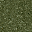 | `orchard` | strikes as dirt, footstep grass, variants orchard |
| 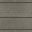 | `bleachers` | strikes as wood, footstep gravel, variants bleachers |
| 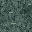 | `creek` | strikes as water, footstep water, variants creek |
|  | `office_wall` | strikes as stone, footstep gravel, variants office_wall, office_wall_win, office_wall_lit, office_wall_brk |
| 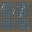 | `glazing` | strikes as glass, footstep gravel, variants glazing |
|  | `powder_panel` | strikes as tin, footstep gravel, variants powder_panel |
|  | `stanky_marquee` | strikes as wood, footstep gravel, variants stanky_marquee |
|  | `feed_marquee` | strikes as wood, footstep gravel, variants feed_marquee |
|  | `cable` | strikes as wood, footstep gravel, variants cable |
|  | `oil_asphalt` | strikes as dirt, footstep gravel, variants oil_asphalt |
| 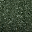 | `hedgerow` | strikes as brush, footstep gravel, variants hedgerow |
|  | `fair_booth` | strikes as wood, footstep gravel, variants fair_booth, fair_booth_win, fair_booth_lit, fair_booth_brk |
|  | `fair_iron` | strikes as steel, footstep gravel, variants fair_iron, fair_iron_win, fair_iron_lit, fair_iron_brk |
|  | `fair_gravel` | strikes as dirt, footstep gravel, variants fair_gravel |
| 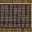 | `fair_gate` | strikes as steel, footstep gravel, variants fair_gate |
|  | `fair_prize` | strikes as wood, footstep gravel, variants fair_prize |
| 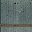 | `mill_tin` | strikes as tin, footstep gravel, variants mill_tin, mill_tin_win, mill_tin_lit, mill_tin_brk |
|  | `mill_water` | strikes as water, footstep water, variants mill_water |
| 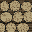 | `mill_log` | strikes as timber, footstep gravel, variants mill_log |
| 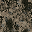 | `mill_oil` | strikes as dirt, footstep gravel, variants mill_oil |
| 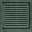 | `mill_pump` | strikes as steel, footstep gravel, variants mill_pump |
| 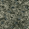 | `mill_grit` | strikes as dirt, footstep gravel, variants mill_grit |
|  | `route_hickston` | strikes as dirt, footstep gravel, variants route_hickston |
|  | `route_fair` | strikes as dirt, footstep gravel, variants route_fair |
|  | `route_sawmill` | strikes as dirt, footstep gravel, variants route_sawmill |
|  | `route_quarry` | strikes as dirt, footstep gravel, variants route_quarry |
|  | `route_hub` | strikes as dirt, footstep gravel, variants route_hub |
|  | `route_closed` | strikes as dirt, footstep gravel, variants route_closed |
|  | `quarry_face` | strikes as stone, footstep gravel, variants quarry_face |
| 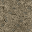 | `quarry_dust` | strikes as dirt, footstep gravel, variants quarry_dust |
| 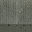 | `quarry_iron` | strikes as steel, footstep gravel, variants quarry_iron, quarry_iron_win, quarry_iron_lit, quarry_iron_brk |
| 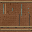 | `quarry_copper` | strikes as steel, footstep gravel, variants quarry_copper |
| 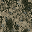 | `quarry_shed` | strikes as wood, footstep gravel, variants quarry_shed, quarry_shed_win, quarry_shed_lit, quarry_shed_brk |
| 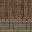 | `feed_wash` | strikes as wood, footstep gravel, variants feed_wash |
|  | `fair_marquee` | strikes as wood, footstep gravel, variants fair_marquee |
| 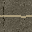 | `route_threshold` | strikes as dirt, footstep gravel, variants route_threshold |
|  | `hub_patch` | strikes as dirt, footstep gravel, variants hub_patch |
| 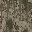 | `hub_service_wall` | strikes as stone, footstep gravel, variants hub_service_wall, hub_service_wall_win, hub_service_wall_lit |
| 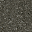 | `hub_runoff` | strikes as water, footstep gravel, variants hub_runoff |
|  | `hub_screen` | strikes as glass, footstep gravel, variants hub_screen |
|  | `hub_tank_shell` | strikes as steel, footstep gravel, variants hub_tank_shell |
|  | `detail_wall_bar_wainscot` | strikes as stone, footstep gravel, variants detail_wall_bar_wainscot |
|  | `detail_wall_garage_courses` | strikes as brick, footstep gravel, variants detail_wall_garage_courses |
|  | `detail_wall_feed_pen_boards` | strikes as wood, footstep gravel, variants detail_wall_feed_pen_boards |
| 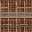 | `detail_wall_raffle_stripes` | strikes as wood, footstep gravel, variants detail_wall_raffle_stripes |
| 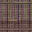 | `detail_wall_prize_skirting` | strikes as wood, footstep gravel, variants detail_wall_prize_skirting |
| 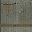 | `detail_wall_kiln_patches` | strikes as tin, footstep gravel, variants detail_wall_kiln_patches |
| 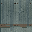 | `detail_wall_rain_sheets` | strikes as tin, footstep gravel, variants detail_wall_rain_sheets |
|  | `detail_wall_chalk_cut` | strikes as stone, footstep gravel, variants detail_wall_chalk_cut |
| 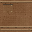 | `detail_wall_copper_seams` | strikes as steel, footstep gravel, variants detail_wall_copper_seams |
| 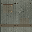 | `detail_wall_shed_repair` | strikes as tin, footstep gravel, variants detail_wall_shed_repair |
|  | `detail_wall_approach_fence` | strikes as wood, footstep gravel, variants detail_wall_approach_fence |
| 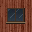 | `barn_win` | strikes as wood, footstep gravel, variants barn, barn_win, barn_lit, barn_brk |
| 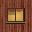 | `barn_lit` | strikes as wood, footstep gravel, variants barn, barn_win, barn_lit, barn_brk |
| 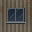 | `tin_win` | strikes as tin, footstep gravel, variants tin, tin_win, tin_lit, tin_brk |
| 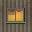 | `tin_lit` | strikes as tin, footstep gravel, variants tin, tin_win, tin_lit, tin_brk |
|  | `brick_win` | strikes as brick, footstep gravel, variants brick, brick_win, brick_lit, brick_brk |
|  | `brick_lit` | strikes as brick, footstep gravel, variants brick, brick_win, brick_lit, brick_brk |
| 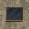 | `plaster_win` | strikes as stone, footstep gravel, variants plaster, plaster_win, plaster_lit, plaster_brk |
|  | `plaster_lit` | strikes as stone, footstep gravel, variants plaster, plaster_win, plaster_lit, plaster_brk |
| 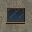 | `cinder_win` | strikes as stone, footstep gravel, variants cinder, cinder_win, cinder_lit, cinder_brk |
| 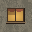 | `cinder_lit` | strikes as stone, footstep gravel, variants cinder, cinder_win, cinder_lit, cinder_brk |
| 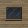 | `office_wall_win` | strikes as stone, footstep gravel, variants office_wall, office_wall_win, office_wall_lit, office_wall_brk |
| 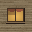 | `office_wall_lit` | strikes as stone, footstep gravel, variants office_wall, office_wall_win, office_wall_lit, office_wall_brk |
| 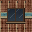 | `fair_booth_win` | strikes as wood, footstep gravel, variants fair_booth, fair_booth_win, fair_booth_lit, fair_booth_brk |
|  | `fair_booth_lit` | strikes as wood, footstep gravel, variants fair_booth, fair_booth_win, fair_booth_lit, fair_booth_brk |
|  | `fair_iron_win` | strikes as steel, footstep gravel, variants fair_iron, fair_iron_win, fair_iron_lit, fair_iron_brk |
|  | `fair_iron_lit` | strikes as steel, footstep gravel, variants fair_iron, fair_iron_win, fair_iron_lit, fair_iron_brk |
|  | `mill_tin_win` | strikes as tin, footstep gravel, variants mill_tin, mill_tin_win, mill_tin_lit, mill_tin_brk |
|  | `mill_tin_lit` | strikes as tin, footstep gravel, variants mill_tin, mill_tin_win, mill_tin_lit, mill_tin_brk |
|  | `quarry_iron_win` | strikes as steel, footstep gravel, variants quarry_iron, quarry_iron_win, quarry_iron_lit, quarry_iron_brk |
|  | `quarry_iron_lit` | strikes as steel, footstep gravel, variants quarry_iron, quarry_iron_win, quarry_iron_lit, quarry_iron_brk |
|  | `quarry_shed_win` | strikes as wood, footstep gravel, variants quarry_shed, quarry_shed_win, quarry_shed_lit, quarry_shed_brk |
|  | `quarry_shed_lit` | strikes as wood, footstep gravel, variants quarry_shed, quarry_shed_win, quarry_shed_lit, quarry_shed_brk |
|  | `hub_service_wall_win` | strikes as stone, footstep gravel, variants hub_service_wall, hub_service_wall_win, hub_service_wall_lit |
|  | `hub_service_wall_lit` | strikes as stone, footstep gravel, variants hub_service_wall, hub_service_wall_win, hub_service_wall_lit |
|  | `trim_foundation` | strikes as brick, footstep gravel, variants trim_foundation |
|  | `trim_eave` | strikes as wood, footstep gravel, variants trim_eave |
|  | `corn` | strikes as brush, footstep gravel, variants corn |
|  | `track_dirt` | strikes as dirt, footstep mud, variants track_dirt |
|  | `track_chalk` | strikes as dirt, footstep mud, variants track_chalk |
|  | `derby_mud` | strikes as dirt, footstep mud, variants derby_mud |
|  | `junk_ground` | strikes as dirt, footstep gravel, variants junk_ground |
|  | `diner_checker` | strikes as stone, footstep tile, variants diner_checker |
|  | `crash_wall` | strikes as stone, footstep gravel, variants crash_wall |
|  | `tire_wall` | strikes as rubber, footstep gravel, variants tire_wall |
|  | `junk_stack` | strikes as steel, footstep gravel, variants junk_stack |
|  | `garage_door` | strikes as tin, footstep gravel, variants garage_door |
|  | `grandstand_riser` | strikes as stone, footstep gravel, variants grandstand_riser |
|  | `speedway_marquee` | strikes as wood, footstep gravel, variants speedway_marquee |
|  | `diner_steel` | strikes as steel, footstep gravel, variants diner_steel, diner_steel_win, diner_steel_lit, diner_steel_brk |
|  | `diner_steel_win` | strikes as steel, footstep gravel, variants diner_steel, diner_steel_win, diner_steel_lit, diner_steel_brk |
|  | `diner_steel_lit` | strikes as steel, footstep gravel, variants diner_steel, diner_steel_win, diner_steel_lit, diner_steel_brk |
|  | `checker_band` | strikes as stone, footstep gravel, variants checker_band |
|  | `bayou_water` | strikes as water, footstep water, variants bayou_water |
|  | `bayou_deep` | strikes as water, footstep water, variants bayou_deep |
|  | `bayou_planks` | strikes as wood, footstep wood, variants bayou_planks |
|  | `bayou_mud` | strikes as dirt, footstep mud, variants bayou_mud |
|  | `bayou_marsh` | strikes as dirt, footstep grass, variants bayou_marsh |
|  | `bayou_stilts` | strikes as timber, footstep gravel, variants bayou_stilts |
|  | `bayou_bank` | strikes as dirt, footstep gravel, variants bayou_bank |
|  | `bayou_cypress` | strikes as timber, footstep gravel, variants bayou_cypress |
|  | `bayou_tin` | strikes as tin, footstep gravel, variants bayou_tin, bayou_tin_win, bayou_tin_lit, bayou_tin_brk |
|  | `bayou_shack` | strikes as wood, footstep gravel, variants bayou_shack, bayou_shack_win, bayou_shack_lit, bayou_shack_brk |
|  | `bayou_cannery` | strikes as stone, footstep gravel, variants bayou_cannery, bayou_cannery_win, bayou_cannery_lit, bayou_cannery_brk |
|  | `bayou_juke` | strikes as wood, footstep gravel, variants bayou_juke |
|  | `bayou_pen` | strikes as mesh, footstep gravel, variants bayou_pen |
|  | `bayou_reeds` | strikes as brush, footstep gravel, variants bayou_reeds |
|  | `bayou_bridge` | strikes as wood, footstep gravel, variants bayou_bridge |
|  | `bayou_juke_marquee` | strikes as wood, footstep gravel, variants bayou_juke_marquee |
|  | `bayou_bait_neon` | strikes as wood, footstep gravel, variants bayou_bait_neon |
|  | `bayou_tin_win` | strikes as tin, footstep gravel, variants bayou_tin, bayou_tin_win, bayou_tin_lit, bayou_tin_brk |
|  | `bayou_tin_lit` | strikes as tin, footstep gravel, variants bayou_tin, bayou_tin_win, bayou_tin_lit, bayou_tin_brk |
|  | `bayou_shack_win` | strikes as wood, footstep gravel, variants bayou_shack, bayou_shack_win, bayou_shack_lit, bayou_shack_brk |
|  | `bayou_shack_lit` | strikes as wood, footstep gravel, variants bayou_shack, bayou_shack_win, bayou_shack_lit, bayou_shack_brk |
|  | `bayou_cannery_win` | strikes as stone, footstep gravel, variants bayou_cannery, bayou_cannery_win, bayou_cannery_lit, bayou_cannery_brk |
|  | `bayou_cannery_lit` | strikes as stone, footstep gravel, variants bayou_cannery, bayou_cannery_win, bayou_cannery_lit, bayou_cannery_brk |
|  | `ship_hull` | strikes as steel, footstep gravel, variants ship_hull |
|  | `ship_tin` | strikes as tin, footstep gravel, variants ship_tin |
|  | `ship_rib` | strikes as steel, footstep gravel, variants ship_rib |
|  | `ship_panel` | strikes as steel, footstep gravel, variants ship_panel |
|  | `ship_core` | strikes as steel, footstep gravel, variants ship_core |
|  | `ship_screen` | strikes as glass, footstep gravel, variants ship_screen |
|  | `ship_deck` | strikes as steel, footstep tile, variants ship_deck |
|  | `ship_grate` | strikes as steel, footstep tile, variants ship_grate |
|  | `ship_ceiling` | strikes as steel, footstep gravel, variants ship_ceiling |
|  | `ship_door` | strikes as steel, footstep gravel, variants ship_door |
|  | `ship_beam` | strikes as steel, footstep gravel, variants ship_beam |
|  | `ship_edge` | strikes as steel, footstep gravel, variants ship_edge |
|  | `ship_pod` | strikes as steel, footstep gravel, variants ship_pod |
|  | `ship_vat` | strikes as steel, footstep gravel, variants ship_vat |
|  | `ship_lino` | strikes as steel, footstep tile, variants ship_lino |
|  | `route_bayou` | strikes as dirt, footstep gravel, variants route_bayou |
|  | `route_speedway` | strikes as dirt, footstep gravel, variants route_speedway |
|  | `route_mothership` | strikes as dirt, footstep gravel, variants route_mothership |
|  | `barn_brk` | strikes as wood, footstep gravel, variants barn, barn_win, barn_lit, barn_brk |
|  | `tin_brk` | strikes as tin, footstep gravel, variants tin, tin_win, tin_lit, tin_brk |
|  | `brick_brk` | strikes as brick, footstep gravel, variants brick, brick_win, brick_lit, brick_brk |
|  | `plaster_brk` | strikes as stone, footstep gravel, variants plaster, plaster_win, plaster_lit, plaster_brk |
|  | `cinder_brk` | strikes as stone, footstep gravel, variants cinder, cinder_win, cinder_lit, cinder_brk |
|  | `office_wall_brk` | strikes as stone, footstep gravel, variants office_wall, office_wall_win, office_wall_lit, office_wall_brk |
|  | `fair_booth_brk` | strikes as wood, footstep gravel, variants fair_booth, fair_booth_win, fair_booth_lit, fair_booth_brk |
|  | `fair_iron_brk` | strikes as steel, footstep gravel, variants fair_iron, fair_iron_win, fair_iron_lit, fair_iron_brk |
|  | `mill_tin_brk` | strikes as tin, footstep gravel, variants mill_tin, mill_tin_win, mill_tin_lit, mill_tin_brk |
|  | `quarry_iron_brk` | strikes as steel, footstep gravel, variants quarry_iron, quarry_iron_win, quarry_iron_lit, quarry_iron_brk |
|  | `quarry_shed_brk` | strikes as wood, footstep gravel, variants quarry_shed, quarry_shed_win, quarry_shed_lit, quarry_shed_brk |
|  | `bayou_tin_brk` | strikes as tin, footstep gravel, variants bayou_tin, bayou_tin_win, bayou_tin_lit, bayou_tin_brk |
|  | `bayou_shack_brk` | strikes as wood, footstep gravel, variants bayou_shack, bayou_shack_win, bayou_shack_lit, bayou_shack_brk |
|  | `bayou_cannery_brk` | strikes as stone, footstep gravel, variants bayou_cannery, bayou_cannery_win, bayou_cannery_lit, bayou_cannery_brk |
|  | `diner_steel_brk` | strikes as steel, footstep gravel, variants diner_steel, diner_steel_win, diner_steel_lit, diner_steel_brk |
|  | `trailer_brk` | strikes as tin, footstep gravel, variants trailer, trailer_brk |
|  | `stockyard_hit` | strikes as wood, footstep gravel, variants stockyard_hit |

## Props

| | id | notes |
| --- | --- | --- |
|  | `airboat` | prop, 2.11 high, 3.21 wide |
|  | `alien_console` | prop, 1.53 high, 1.35 wide |
|  | `alien_crate` | prop, 0.85 high, 1.23 wide |
|  | `alien_crate_broken` | prop, 0.85 high, 1.8 wide |
|  | `axe_stump` | prop, 1.18 high, 0.72 wide |
|  | `bait_cooler_rack` | prop, 2.05 high, 1.25 wide |
|  | `bait_tank` | prop, 1.93 high, 1.95 wide |
|  | `balloons` | prop, 1.99 high, 1.1 wide |
|  | `balloons_broken` | prop, 1.95 high, 0.75 wide |
|  | `barrel_broken` | prop, 0.67 high, 1.62 wide |
|  | `bathtub` | prop, 0.78 high, 1.44 wide |
|  | `beam_emitter` | prop, 0.88 high, 1.8 wide |
|  | `belt_conveyor` | prop, 1.74 high, 3.54 wide |
|  | `boil_pot` | prop, 1.85 high, 1.45 wide |
|  | `boil_table` | prop, 1.15 high, 2.09 wide |
|  | `boulder_a` | prop, 1.18 high, 1.67 wide |
|  | `boulder_b` | prop, 1.18 high, 1.0 wide |
|  | `bunk` | prop, 1.9 high, 1.98 wide |
|  | `burn_barrel` | prop, 1.4 high, 0.62 wide |
|  | `cable_spool` | prop, 1.24 high, 1.23 wide |
|  | `camp_chairs` | prop, 1.05 high, 1.54 wide |
|  | `canned_ham` | prop, 1.58 high, 3.29 wide |
|  | `captain_chair` | prop, 1.58 high, 1.49 wide |
|  | `car_crusher` | prop, 3.01 high, 3.63 wide |
|  | `carousel_horse` | prop, 2.19 high, 1.05 wide |
|  | `chicken_coop` | prop, 1.6 high, 1.73 wide |
|  | `cooler` | prop, 0.63 high, 0.85 wide |
|  | `cooler_broken` | prop, 0.62 high, 1.27 wide |
|  | `copper_vat` | prop, 2.25 high, 1.74 wide |
|  | `corn_tray` | prop, 2.2 high, 1.48 wide |
|  | `cotton_candy` | prop, 1.93 high, 1.3 wide |
|  | `cow_tube` | prop, 2.74 high, 1.32 wide |
|  | `cow_tube_broken` | prop, 2.82 high, 2.0 wide |
|  | `crane_hook` | prop, 3.49 high, 4.06 wide |
|  | `crate_broken` | prop, 0.76 high, 1.72 wide |
|  | `crawfish_traps` | prop, 1.12 high, 1.28 wide |
|  | `crushed_stack` | prop, 1.39 high, 2.4 wide |
|  | `crusher` | prop, 2.63 high, 2.29 wide |
|  | `cypress` | prop, 4.78 high, 2.31 wide |
|  | `cypress_b` | prop, 3.63 high, 1.76 wide |
|  | `cypress_knees` | prop, 0.82 high, 1.08 wide |
|  | `dead_snag` | prop, 3.15 high, 1.49 wide |
|  | `deer_target` | prop, 1.42 high, 1.15 wide |
|  | `derby_car` | prop, 1.28 high, 2.41 wide |
|  | `dish` | prop, 1.47 high, 1.13 wide |
|  | `doghouse` | prop, 1.1 high, 1.54 wide |
|  | `drill_rig` | prop, 3.28 high, 1.89 wide |
|  | `dump_truck` | prop, 2.03 high, 2.49 wide |
|  | `engine_hoist` | prop, 2.3 high, 1.81 wide |
|  | `engine_stand` | prop, 1.2 high, 0.99 wide |
|  | `escape_outhouse` | prop, 2.99 high, 1.65 wide |
|  | `ferris_wheel` | prop, 5.83 high, 4.25 wide |
|  | `flag_stand` | prop, 3.47 high, 2.04 wide |
|  | `flamingo` | prop, 1.02 high, 0.51 wide |
|  | `flamingo_broken` | prop, 0.28 high, 1.01 wide |
|  | `floodlight_tower` | prop, 7.31 high, 1.47 wide |
|  | `forklift` | prop, 1.88 high, 2.19 wide |
|  | `fridge` | prop, 1.64 high, 1.0 wide |
|  | `fuel_drum_burst` | prop, 0.92 high, 1.31 wide |
|  | `fuel_pump` | prop, 2.0 high, 0.83 wide |
|  | `fuel_tank` | prop, 2.36 high, 2.5 wide |
|  | `gas_cans` | prop, 0.5 high, 0.68 wide |
|  | `gas_cans_broken` | prop, 0.48 high, 1.0 wide |
|  | `gator_hide` | prop, 1.8 high, 2.23 wide |
|  | `generator` | prop, 1.48 high, 1.75 wide |
|  | `giant_gator` | prop, 1.32 high, 4.8 wide |
|  | `giant_hog` | prop, 2.42 high, 2.99 wide |
|  | `grill` | prop, 1.42 high, 1.09 wide |
|  | `hay_wagon` | prop, 1.43 high, 2.05 wide |
|  | `headrig` | prop, 2.14 high, 3.95 wide |
|  | `heron` | prop, 1.32 high, 0.85 wide |
|  | `high_striker` | prop, 3.28 high, 0.8 wide |
|  | `hubcap_board` | prop, 1.0 high, 1.84 wide |
|  | `hung_pickup` | prop, 1.85 high, 2.43 wide |
|  | `ice_chest` | prop, 0.67 high, 0.94 wide |
|  | `ice_chest_broken` | prop, 0.64 high, 1.38 wide |
|  | `jug_stack` | prop, 0.73 high, 1.08 wide |
|  | `jug_stack_broken` | prop, 0.64 high, 1.11 wide |
|  | `jukebox_rig` | prop, 2.05 high, 1.7 wide |
|  | `lantern_post` | prop, 1.6 high, 0.45 wide |
|  | `laundry` | prop, 0.93 high, 2.6 wide |
|  | `log_loader` | prop, 2.58 high, 3.7 wide |
|  | `log_pile` | prop, 1.49 high, 2.75 wide |
|  | `lumber_cart` | prop, 1.21 high, 1.94 wide |
|  | `lumber_stack` | prop, 1.07 high, 2.48 wide |
|  | `magnet_crane` | prop, 5.33 high, 4.53 wide |
|  | `mailbox_row` | prop, 1.19 high, 1.13 wide |
|  | `mailbox_row_broken` | prop, 1.2 high, 1.42 wide |
|  | `marina_pump` | prop, 1.87 high, 0.71 wide |
|  | `mash_barrel` | prop, 1.63 high, 1.63 wide |
|  | `mash_barrel_broken` | prop, 1.02 high, 2.0 wide |
|  | `mine_cart` | prop, 1.14 high, 2.43 wide |
|  | `monster_truck` | prop, 2.71 high, 3.13 wide |
|  | `net_rack` | prop, 2.12 high, 1.79 wide |
|  | `nitro_rack` | prop, 1.29 high, 0.93 wide |
|  | `nitro_rack_broken` | prop, 1.37 high, 1.06 wide |
|  | `outboard_stand` | prop, 1.21 high, 1.05 wide |
|  | `outhouse` | prop, 2.4 high, 1.51 wide |
|  | `pa_horns` | prop, 3.29 high, 1.25 wide |
|  | `pallet_stack` | prop, 0.85 high, 1.42 wide |
|  | `pallet_stack_broken` | prop, 0.52 high, 1.97 wide |
|  | `picnic_table` | prop, 1.0 high, 1.96 wide |
|  | `pirogue` | prop, 0.4 high, 2.21 wide |
|  | `pod` | prop, 2.15 high, 1.35 wide |
|  | `porch_couch` | prop, 1.08 high, 1.78 wide |
|  | `port_a_john` | prop, 2.38 high, 1.35 wide |
|  | `powder_shelf` | prop, 2.25 high, 1.78 wide |
|  | `prize_bear` | prop, 1.44 high, 1.0 wide |
|  | `prize_bear_broken` | prop, 0.93 high, 1.64 wide |
|  | `probe_rack` | prop, 1.1 high, 1.7 wide |
|  | `probe_table` | prop, 2.06 high, 1.98 wide |
|  | `propane_tank` | prop, 1.21 high, 1.79 wide |
|  | `propane_tank_broken` | prop, 1.27 high, 1.78 wide |
|  | `pylon` | prop, 1.55 high, 0.44 wide |
|  | `quest_bell_off` | prop, 1.49 high, 1.02 wide |
|  | `quest_bell_on` | prop, 1.49 high, 1.02 wide |
|  | `quest_bolt_off` | prop, 1.34 high, 0.84 wide |
|  | `quest_bolt_on` | prop, 1.34 high, 0.84 wide |
|  | `quest_brake_off` | prop, 1.33 high, 1.16 wide |
|  | `quest_brake_on` | prop, 1.33 high, 1.16 wide |
|  | `quest_condenser_off` | prop, 1.34 high, 0.72 wide |
|  | `quest_condenser_on` | prop, 1.34 high, 0.72 wide |
|  | `quest_estop_off` | prop, 1.35 high, 0.57 wide |
|  | `quest_estop_on` | prop, 1.35 high, 0.57 wide |
|  | `quest_exit_fair_off` | prop, 1.68 high, 1.13 wide |
|  | `quest_exit_fair_on` | prop, 1.68 high, 1.13 wide |
|  | `quest_exit_flag_off` | prop, 1.7 high, 0.84 wide |
|  | `quest_exit_flag_on` | prop, 1.7 high, 0.84 wide |
|  | `quest_exit_off` | prop, 1.68 high, 1.13 wide |
|  | `quest_exit_on` | prop, 1.68 high, 1.13 wide |
|  | `quest_flag_off` | prop, 1.39 high, 0.69 wide |
|  | `quest_flag_on` | prop, 1.39 high, 0.69 wide |
|  | `quest_fuel_drum_off` | prop, 1.12 high, 1.12 wide |
|  | `quest_fuel_drum_on` | prop, 1.12 high, 1.12 wide |
|  | `quest_fuel_dump_off` | prop, 1.35 high, 0.69 wide |
|  | `quest_fuel_dump_on` | prop, 1.35 high, 0.69 wide |
|  | `quest_generator_off` | prop, 1.39 high, 1.16 wide |
|  | `quest_generator_on` | prop, 1.39 high, 1.16 wide |
|  | `quest_ignition_off` | prop, 1.29 high, 0.45 wide |
|  | `quest_ignition_on` | prop, 1.29 high, 0.45 wide |
|  | `quest_latch_off` | prop, 1.17 high, 1.32 wide |
|  | `quest_latch_on` | prop, 1.17 high, 1.32 wide |
|  | `quest_pa_rig_off` | prop, 1.53 high, 0.86 wide |
|  | `quest_pa_rig_on` | prop, 1.53 high, 0.86 wide |
|  | `quest_patchbay_off` | prop, 1.34 high, 0.67 wide |
|  | `quest_patchbay_on` | prop, 1.34 high, 0.67 wide |
|  | `quest_relay_off` | prop, 1.34 high, 0.77 wide |
|  | `quest_relay_on` | prop, 1.34 high, 0.77 wide |
|  | `quest_ship_drain_off` | prop, 1.36 high, 0.57 wide |
|  | `quest_ship_drain_on` | prop, 1.36 high, 0.57 wide |
|  | `quest_ship_drive_off` | prop, 1.37 high, 0.78 wide |
|  | `quest_ship_drive_on` | prop, 1.37 high, 0.78 wide |
|  | `quest_ship_iris_off` | prop, 1.15 high, 0.72 wide |
|  | `quest_ship_iris_on` | prop, 1.15 high, 0.72 wide |
|  | `quest_ship_launch_off` | prop, 1.33 high, 0.66 wide |
|  | `quest_ship_launch_on` | prop, 1.33 high, 0.66 wide |
|  | `quest_switch_bayou_off` | prop, 1.36 high, 0.61 wide |
|  | `quest_switch_bayou_on` | prop, 1.36 high, 0.61 wide |
|  | `quest_switch_fair_off` | prop, 1.34 high, 0.63 wide |
|  | `quest_switch_fair_on` | prop, 1.34 high, 0.63 wide |
|  | `quest_switch_off` | prop, 1.35 high, 0.63 wide |
|  | `quest_switch_on` | prop, 1.35 high, 0.63 wide |
|  | `quest_switch_speedway_off` | prop, 1.34 high, 0.63 wide |
|  | `quest_switch_speedway_on` | prop, 1.34 high, 0.63 wide |
|  | `quest_valve_off` | prop, 1.22 high, 0.7 wide |
|  | `quest_valve_on` | prop, 1.22 high, 0.7 wide |
|  | `race_car_0` | prop, 1.09 high, 1.21 wide |
|  | `race_car_1` | prop, 1.12 high, 2.47 wide |
|  | `race_car_2` | prop, 1.02 high, 2.59 wide |
|  | `race_car_3` | prop, 1.05 high, 2.47 wide |
|  | `race_car_4` | prop, 1.0 high, 1.21 wide |
|  | `race_car_5` | prop, 1.05 high, 2.47 wide |
|  | `race_car_6` | prop, 1.02 high, 2.59 wide |
|  | `race_car_7` | prop, 1.12 high, 2.47 wide |
|  | `range_ammo_crate` | prop, 0.81 high, 1.02 wide |
|  | `range_ammo_crate_broken` | prop, 0.51 high, 1.79 wide |
|  | `range_bench` | prop, 1.05 high, 1.52 wide |
|  | `range_cow_target` | prop, 1.3 high, 1.64 wide |
|  | `range_duck` | prop, 0.56 high, 0.72 wide |
|  | `range_dummy` | prop, 1.72 high, 1.28 wide |
|  | `range_floodlight` | prop, 4.39 high, 1.2 wide |
|  | `range_gong` | prop, 1.53 high, 1.38 wide |
|  | `range_gun_rack` | prop, 1.68 high, 1.56 wide |
|  | `range_hay_bale` | prop, 1.0 high, 1.13 wide |
|  | `range_hay_bale_broken` | prop, 0.64 high, 1.5 wide |
|  | `range_lever` | prop, 1.41 high, 0.43 wide |
|  | `range_loudspeaker` | prop, 4.07 high, 1.01 wide |
|  | `range_pin` | prop, 0.35 high, 0.13 wide |
|  | `range_pin_down` | prop, 0.14 high, 0.36 wide |
|  | `range_sandbags` | prop, 0.71 high, 1.58 wide |
|  | `range_scoreboard` | prop, 2.4 high, 1.9 wide |
|  | `range_target` | prop, 1.34 high, 1.04 wide |
|  | `rock_chute` | prop, 2.91 high, 3.06 wide |
|  | `rocker` | prop, 1.19 high, 1.02 wide |
|  | `safe_open` | prop, 0.93 high, 1.12 wide |
|  | `saucer_wreck` | prop, 1.79 high, 4.25 wide |
|  | `saw_blade` | prop, 2.34 high, 1.98 wide |
|  | `sawdust_pile` | prop, 0.95 high, 2.0 wide |
|  | `scarecrow` | prop, 2.1 high, 1.5 wide |
|  | `school_bus` | prop, 2.09 high, 5.97 wide |
|  | `searchlight` | prop, 1.33 high, 0.95 wide |
|  | `semi_tractor` | prop, 3.05 high, 3.29 wide |
|  | `shine_tank` | prop, 1.81 high, 1.93 wide |
|  | `ship_engine` | prop, 2.7 high, 1.95 wide |
|  | `skiff` | prop, 0.93 high, 3.49 wide |
|  | `skull_post` | prop, 1.37 high, 0.68 wide |
|  | `sorting_table` | prop, 1.23 high, 2.75 wide |
|  | `specimen_jar` | prop, 1.35 high, 0.54 wide |
|  | `specimen_jar_broken` | prop, 1.16 high, 0.99 wide |
|  | `still` | prop, 1.3 high, 1.49 wide |
|  | `stock_car` | prop, 1.05 high, 2.71 wide |
|  | `stock_car_b` | prop, 1.14 high, 2.49 wide |
|  | `stone_blocks` | prop, 1.88 high, 2.51 wide |
|  | `stone_sledge` | prop, 1.33 high, 2.75 wide |
|  | `strongbox` | prop, 0.61 high, 0.72 wide |
|  | `tire_pile` | prop, 1.23 high, 1.92 wide |
|  | `tire_stack` | prop, 0.89 high, 0.75 wide |
|  | `tnt_crate` | prop, 0.9 high, 0.99 wide |
|  | `tnt_crate_broken` | prop, 0.53 high, 1.54 wide |
|  | `tombstone_a` | prop, 0.77 high, 0.54 wide |
|  | `tombstone_b` | prop, 0.85 high, 0.52 wide |
|  | `tombstone_c` | prop, 0.65 high, 0.61 wide |
|  | `tool_chest` | prop, 1.33 high, 0.98 wide |
|  | `tow_truck` | prop, 1.9 high, 3.19 wide |
|  | `tractor` | prop, 2.08 high, 2.09 wide |
|  | `trophy` | prop, 1.46 high, 0.81 wide |
|  | `trophy_gnome` | prop, 1.6 high, 0.89 wide |
|  | `truck_blocks` | prop, 1.49 high, 2.13 wide |
|  | `warning_barrel` | prop, 0.98 high, 0.61 wide |
|  | `warning_barrel_broken` | prop, 0.66 high, 1.29 wide |
|  | `washer` | prop, 1.16 high, 0.95 wide |
|  | `wheelbarrow` | prop, 0.74 high, 1.14 wide |
|  | `wreck_pickup` | prop, 1.39 high, 2.08 wide |
|  | `wreck_sedan` | prop, 1.28 high, 2.13 wide |
|  | `wrecked_derby` | prop, 1.43 high, 2.2 wide |
|  | `barrel` | flat prop, 1.04 high |
|  | `hay` | flat prop, 0.91 high |
|  | `pump` | flat prop, 1.43 high |
|  | `pump_b` | flat prop, 1.43 high |
|  | `sink` | flat prop, 0.89 high |
|  | `crate` | flat prop, 0.75 high |
|  | `jukebox` | flat prop, 1.45 high |
|  | `lamp` | flat prop, 0.24 high |
|  | `tree` | flat prop, 3.65 high |
|  | `tree_b` | flat prop, 3.65 high |
|  | `utilitypole` | flat prop, 3.85 high |
|  | `pickup_truck` | flat prop, 1.31 high |
|  | `pickup_truck_b` | flat prop, 1.2 high |
|  | `roadsign` | flat prop, 1.67 high |
|  | `bleacher_sign` | flat prop, 1.58 high |
|  | `mailbox` | flat prop, 1.18 high |
|  | `tire` | flat prop, 0.4 high |
|  | `windmill` | flat prop, 4.65 high |
|  | `silo` | flat prop, 3.78 high |
|  | `reeds` | flat prop, 0.58 high |
|  | `water_tower` | flat prop, 5.1 high |

## Enemies

| | id | notes |
| --- | --- | --- |
|  | `clone` | brain clone, health 60 |
|  | `billy` | brain billy, health 70 |
|  | `coot` | brain coot, health 53 |
|  | `skeeter` | brain skeeter, health 36 |
|  | `alien` | brain alien, health 91 |
|  | `saucer` | brain saucer, health 75 |
|  | `boss` | brain boss, health 1300, boss |
|  | `jerry` | brain jerry, health 1150, boss |
|  | `barker` | brain barker, health 80 |
|  | `crawler` | brain crawler, health 34 |
|  | `millhand` | brain millhand, health 98 |
|  | `lantern` | brain lantern, health 69 |
|  | `boilerback` | brain boilerback, health 99 |
|  | `chalk_spitter` | brain chalk_spitter, health 52 |
|  | `yard_deputy` | brain yard_deputy, health 64 |
|  | `bottle_tosser` | brain bottle_tosser, health 51 |
|  | `chain_hand` | brain chain_hand, health 78 |
|  | `valve_rat` | brain valve_rat, health 63 |
|  | `rudy` | brain rudy, health 1250, boss |
|  | `foreman` | brain foreman, health 1000, boss |
|  | `baron` | brain baron, health 1300, boss |
|  | `drone` | brain millhand, health 46 |
|  | `tin_guard` | brain alien, health 185 |
|  | `probe` | brain saucer, health 58 |
|  | `maw` | brain maw, health 2400, boss |
|  | `chicken` | brain chicken, health 11 |
|  | `pig` | brain pig, health 22 |
|  | `bessie` | brain bessie, health 100 |
|  | `noodler` | brain millhand, health 118 |
|  | `chum_tosser` | brain bottle_tosser, health 58 |
|  | `gator` | brain crawler, health 82 |
|  | `swamp_king` | brain swamp_king, health 1900, boss |
|  | `pit_mechanic` | brain bottle_tosser, health 62 |
|  | `tire_roller` | brain valve_rat, health 118 |
|  | `nitro_huffer` | brain nitro_huffer, health 40 |
|  | `flagman` | brain flagman, health 56 |
|  | `derby_champ` | brain derby_champ, health 1250, boss |
|  | `big_billy` | brain billy, health 150 |
|  | `drunk_coot` | brain coot, health 82 |
|  | `shield_deputy` | brain yard_deputy, health 70 |
|  | `tough_earl` | brain billy, health 270 |
|  | `tough_clem` | brain barker, health 230 |
|  | `tough_tom` | brain millhand, health 280 |
|  | `tough_bubba` | brain boilerback, health 290 |
|  | `tough_chuck` | brain bottle_tosser, health 190 |
|  | `tough_pete` | brain bottle_tosser, health 200 |
|  | `tough_zorgo` | brain alien, health 300 |

## Pickups

| | id | notes |
| --- | --- | --- |
|  | `arm_ammo` |  |
|  | `armgun` |  |
|  | `beer` |  |
|  | `bottle_launcher` |  |
|  | `bowling_ammo` |  |
|  | `bowling_ball` |  |
|  | `bullets` |  |
|  | `cow_ammo` |  |
|  | `cow_launcher` |  |
|  | `cowpie` |  |
|  | `crossbow` |  |
|  | `crowbar` |  |
|  | `dynamite` |  |
|  | `keg_ammo` |  |
|  | `key_brass` |  |
|  | `key_steel` |  |
|  | `milk_ammo` |  |
|  | `moonshine` |  |
|  | `pa_patch` |  |
|  | `powder_keg` |  |
|  | `pressure_ammo` |  |
|  | `pressure_gun` |  |
|  | `revolver` |  |
|  | `rifle` |  |
|  | `rifle_ammo` |  |
|  | `rinds` |  |
|  | `ripsaw` |  |
|  | `rivet_ammo` |  |
|  | `riveter` |  |
|  | `rocket_ammo` |  |
|  | `saw_ammo` |  |
|  | `shells` |  |
|  | `shotgun` |  |
|  | `slingblade` |  |
|  | `teat_gun` |  |
|  | `tnt` |  |
|  | `whiskey` |  |

